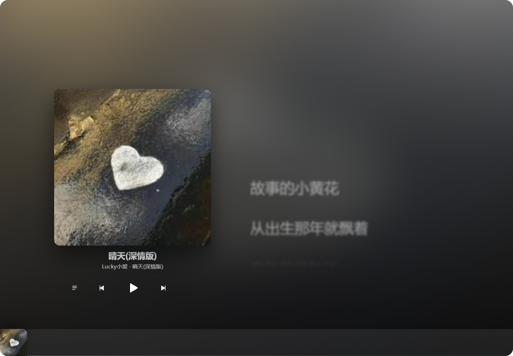

# LIZI · 粒子播放器

用折射型玻璃引擎做的歌词演出器：**可登录你自己的音乐平台账号**，拉真实歌单、真实歌词、真实播放地址。



---

## 下载

| 平台 | 文件 | 夸克网盘 | 百度网盘 |
|---|---|---|---|
| Windows | `LIZI-Setup-1.0.5.exe` | [下载](https://pan.quark.cn/s/fa4fa30384e3) | [下载](https://pan.baidu.com/s/1KNGKoNSfLXC7Wgvd8pcvVg?pwd=lizi) |
| Android | `LIZI-Android-1.0.5-arm64-v8a.apk` | [下载](https://pan.quark.cn/s/3af3bf455dd9) | [下载](https://pan.baidu.com/s/1Nkep3vROfDl8nGOwqp9uTw?pwd=lizi) |

- 百度网盘提取码都是 **`lizi`**；夸克链接点开即可，不需要提取码。
- 手机装 `arm64-v8a` 那个包（现在的手机基本都是 arm64）。`x86_64` 只给模拟器用，GitHub Release 里也附带一份，手机不要装错。
- 安装包和 APK 都没有做代码签名，Windows SmartScreen 可能提示「未知发布者」，选「仍要运行」即可。

---

## 快速开始

双击 **`start.cmd`**（会自动开浏览器）。
或者手动：

```powershell
node server.mjs
```

> 端口是**自动分配**的：Windows 有一批端口被系统保留，写死容易冲突。
> 启动后会打印真实地址，同时写进 `.port` 文件。想固定端口：`$env:PORT=8080; node server.mjs`

要求：Node 18+（用到内置 `fetch`）。**网页版服务端零 npm 依赖**，不用 `npm install`；
桌面打包需要构建依赖（`npm install`，见 [RELEASE.md](RELEASE.md)）。

---

## 登录

登录入口在 **设置页 → 平台账号**，一家一行、一行一个「登录」，没有账号密码表单：

| 平台 | 方式 |
|---|---|
| **网易云** | App 扫码（等待扫码 → 待确认 → 成功/过期自动刷新）；扫码被风控时可在同一弹窗粘贴 `MUSIC_U` Cookie |
| **QQ 音乐** | 用 QQ 音乐 / 手机 QQ / 微信扫码 |
| **酷狗** | 酷狗 App 扫码；未登录能搜，但播放会被酷狗风控拦 |
| **汽水** | 抖音扫码授权；未登录只有 30 秒试听，边车需要本机 Node ≥ 24 |
| **波点** | 扫码登录；未登录只有 30 秒试听，播放只放行中国大陆网络 |

登录态全部存在本机：网易云在根目录 **`.session.json`**，其它平台在各边车自己的 `.auth-*` 文件里，重启仍然是登录状态。
退出登录：同一行行尾的「退出」。

未登录也能用：会展示上游平台的「推荐新歌」，搜索也照常工作。

---

## 功能

- **歌单**：登录后左侧列出你创建 + 收藏的全部歌单，千首以上的大列表也能正常滚动
- **搜索**：顶栏输入即搜（420ms 防抖），结果带**真实专辑封面缩略图**
- **播放页**：点播放条左侧封面进入。默认**封面居中 + 下方 3 行歌词预览**；
  拉起歌词面板后**封面缩小滑到左边**，歌词面板在右侧展开（见下节）
- **节拍检测器**：BPM 优先取上游歌曲百科元数据（约 1 秒出，无倍速歧义），
  缺失时退回实时音频检测；封面跟拍脉动
- **歌词动画模式**：经典 / 聚焦 / 上浮三套可切，选择会记住
- **背景显示封面**：播放时封面大图作为页面背景淡入，同时**按封面色板动态染色**整个背景光斑
- **歌词**：支持 **YRC 逐字歌词**与 LRC 两种格式（见下节）
- **播放**：队列播放、上一首/下一首、顺序 / 单曲循环 / 随机；空格键暂停/播放
- **进度条 / 音量条**：可拖拽，也支持左右方向键（Shift 加速）

---

## 节拍检测器

播放页右下角一块玻璃 HUD，实时显示 BPM、4 拍指示和频谱。

### BPM 来源：歌曲百科元数据优先

上游平台的常规歌曲接口不带 BPM，真正的出处是**歌曲百科**：

```
POST /api/song/play/about/block/page   { songId }
  → data.blocks[] 里 code === 'SONG_PLAY_ABOUT_SONG_BASIC'
  → creatives[] 里 creativeType === 'bpm'
  → uiElement.textLinks[0].text 就是 BPM
```

匿名即可访问，覆盖率 9/9，还顺带提供语言、风格标签与获奖信息。

### 速度与相位分工

元数据和实时检测各管一段：

- **速度（BPM）用元数据**：权威值、约 1 秒就出，而且没有倍速歧义。
- **相位用实时检测**：元数据只说明“多快”，不说明“第一拍落在哪”；
  封面脉动、拍点跳动必须知道相位。锁速之后检测不关，只是不再改 BPM，
  继续用起音把节拍时钟对齐。
- **元数据缺失时整套退回实时检测。**

结果按歌曲 id 缓存进 localStorage（最多 300 首），重播瞬间就有。

### 实时检测算法

`public/beat.js`，三段式：

1. **起音检测**：频谱通量（相邻帧频谱的正向差值累加）。阈值取「局部均值 + 1.15×标准差」，
   再要求是局部极大值且距上次起音 >120ms。窗口取 1.5 秒：太短时窗口里只剩鼓点本身，
   均值和标准差被峰值抬高，阈值水涨船高反而漏掉一半拍子。
2. **速度估计**：对起音强度包络做自相关，在 60~200 BPM 对应的延迟里找峰，
   配合谐波求和与对数先验压制倍速/半速误判。
3. **拍相位**：按 BPM 推进节拍时钟，每次检测到起音就朝最近的预测拍轻推相位（系数 0.22），
   BPM 有零头也能慢慢对齐而不是越跑越偏。

精度：常见速度误差基本为 0，最差 −0.6 BPM；拍间隔抖动约 8ms。

---

## 歌词动画模式

三套全屏歌词动画，播放页顶栏一键切换，选择记在 localStorage：

| 模式 | 效果 |
|---|---|
| **经典** | 当前句放大高亮，逐字卡拉OK 点亮 |
| **聚焦** | 当前句放大，其余句子虚化缩小 —— 像镜头对焦 |
| **上浮** | 唱过的句子向上压暗，未唱的下沉，当前句浮上来 |

逐字歌词（YRC）在三种模式下都走同一套 `.ly__c.is-sung` 逐字点亮逻辑。

---

## 播放页：两种状态，一条过渡

| 状态 | 样子 |
|---|---|
| **默认（收起）** | 封面居中，标题/歌手在下，再下面是**当前句 + 上下各一句**的 3 行歌词预览，底部一根拉起手柄 |
| **拉起** | 封面缩小并滑到**左边**，歌词面板从右侧展开占满剩余宽度 |

拉起方式有三种：点顶栏「拉起歌词」按钮、点 3 行预览区域、**在手柄上往上拖**（往下拖收起，轻点切换）。

**动画设计**：不用 JS 逐帧算位置，而是让两个状态共用一条 CSS 过渡，
靠 `grid-template-columns` 从 `min(0fr)` 到 `minmax(0, 1fr)` 插值：

```css
.now__stage {
  display: grid;
  grid-template-columns: var(--stage-art) var(--stage-ly);
  justify-content: center;            /* 第二轨为 0fr 时把封面居中 */
  transition: grid-template-columns 560ms var(--ease-out), gap 560ms var(--ease-out);
}
```

第二轨长起来后自由空间归零、居中自动失效，封面于是被“推”到左边 ——
**封面的左移、缩小和面板的展开天然是同一条过渡**，不会脱节。

面板的玻璃延迟到第一次拉起时才挂载：收起时宽度是 0，
在 0×0 上挂载会生成无效的位移贴图，展开后折射边缘会整体跑位。

---

## 歌词：YRC 逐字 / LRC 逐行

引擎两种格式都吃，**有 YRC 就用 YRC，没有自动退回 LRC**，播放页右上角会显示当前用的是哪种。

| | 格式 | 效果 |
|---|---|---|
| **YRC** | `[5000,3000](5000,400,0)今(5400,400,0)天…` | **逐字**点亮（卡拉OK）：唱到的字变红加粗，没唱到的保持灰色 |
| **LRC** | `[00:05.00]今天我 寒夜里看雪飘` | 逐行高亮 |

两者都支持**翻译行**（YRC 配 `ytlrc`，LRC 配 `tlyric`）。

### 一个服务端限制

**YRC 由上游平台只在「已登录」时下发。** 匿名请求即使带上 `kv: -1 / yv: -1 / ytv: -1 / yrv: -1` 全部开关，
返回的也只有 `lrc` / `tlyric` / `romalrc`，**`yrc` 字段始终不存在**。

所以：**扫码登录后播放，逐字歌词就会自动生效**，角标会变成「逐字」。
登录前显示的是逐行 LRC —— 这不是降级缺陷，是上游平台的服务端策略。

> `/song/lyric/v1` 在匿名下返回的 `lrc` 是 JSON 结构
> （`{"t":0,"c":[{"tx":"作词: ","li":"http://…jpg"}]}`），其中的 `li` 是**歌手头像图 URL**
> 而不是逐字时间，容易误判成“拿到了逐字”。本项目取同接口的 `yrc` 字段。

---

## 搜索结果封面

搜索接口 `/search/get` 只返回 `album.picId`，不返回 `picUrl`，而 `picId` 与图片文件名并不对应，
无法直接拼出可用的封面地址。

设计上采用 **先搜索、再补封面**：拿到歌曲 id 后批量查询一次 `song/detail`（每批 500 首），
用其中的 `al.picUrl` 回填。代价是多一次请求，换来搜索结果封面完整。

---

## 关于「演示音轨」

上游平台现在对**大量歌曲**返回 `url: null`（会员专享 / 无版权），这是上游策略，不是播放器缺陷。
本播放器的处理方式：

- 拿得到地址 → 放真歌
- 拿不到地址 → 用 WebAudio 现场合成一段 40 秒的和弦琶音（种子取歌曲 id，所以每首歌听感不同），
  播放条上打一个 **「演示音轨」** 角标明确标注

列表里 VIP 曲目会提前标一个 **VIP** 小签，让用户点之前就有预期。

---

## 液态玻璃是怎么接进来的

引擎是零依赖的两个文件（`public/assets/liquid-glass.js` + `.css`），
原理是**运行时按元素像素尺寸生成位移贴图**（R 通道编码横向位移、B 通道编码纵向位移），
再走 `feImage → 3× feDisplacementMap(色散) → feColorMatrix → feBlend(screen)` 滤镜链，
最后交给 `backdrop-filter: url(#id) blur() saturate()`。

页面上一共 **17 个玻璃表面**，按场景分三种挂法：

| 场景 | 挂法 |
|---|---|
| 面板 / 卡片 / 输入框 / 按钮 | 声明式：`class="lg-surface"` + `data-liquid-glass='{...}'` |
| **顶栏 / 播放条** | **bare 模式**：样式自己写，`backdrop-filter` 里拼引擎注入的 `var(--lg-filter)` |
| 视图切换后新增的玻璃 | 命令式 `LiquidGlass.refresh()` |

背景光斑全部用 `radial-gradient`，没有用大尺寸 `filter: blur()` 做动画：
后者在移动端和低性能设备上开销明显更高。另有细网格背景，
专门用来让折射的「推弯 + 红蓝彩边」看得见 —— 纯色背景上是看不出来的。

---

## 设计说明

视觉整理遵循一套统一规范：

- **字体 3 族封顶**。Fraunces（品牌名 + 播放页大标题，做为一个“印出来的”register）· Geist（正文与全部 UI）· Geist Mono（时长、播放数等数字）。全部走 `--font-*` 令牌。
- **禁止 emoji**。所有图标是内联 SVG symbol，通过 `<use href="#i-*">` 引用，换图标就改 href。
- **颜色全部 OKLCH 且令牌化**，只允许引用 `var(--*)`，不内联色值。accent 只有一个（平台强调红）。
- **间距 4pt 级数**，所有留白由 `--sp-1`～`--sp-10` 拼出，没有 7px / 13px 这种野值。
- **统一基线**。全站共用一个 `.shell` 容器，品牌、侧栏、头部卡片左边缘严格对齐。
- **留白**：区块之间 24px、面板内 padding 24–32px、播放页大封面与标题间距 40px。

---

## 已知限制

- **浏览器兼容**：折射与色散**只有 Chromium 内核**（Chrome / Edge）有。
  Safari、Firefox 不解析 `backdrop-filter` 里的 `url()`，会落到前面那条纯 `blur()` 降级声明 —— 变成普通毛玻璃，功能不受影响。
- **网易云二维码**由公开的 `api.qrserver.com` 渲染（内容就是登录 key）。
  完全离线环境下二维码图会加载失败，可在同一弹窗里粘贴 `MUSIC_U` Cookie 登录。
  酷狗 / 汽水 / 波点的二维码由各家官方接口直接下发图片，不走这个服务。
- **封面取色**依赖 `<canvas>` 读像素，必须走同源代理（`/api/img`）。
  直接用平台原图会因缺 CORS 头污染画布，`getImageData` 抛 `SecurityError`。
- 网易云扫码通道偶尔会被上游风控挑中，此时改用同一弹窗里的 `MUSIC_U` Cookie 登录。

---

## 法律与免责声明

本项目在 AI 辅助下开发，仍可能存在未被发现的问题，使用时请自行评估。

本项目只展示播放动效、界面设计与工程实现，不提供、不存储任何音乐内容。应用内涉及的音频、歌词、封面及其他素材，版权均归对应权利人所有。

仓库与源代码仅供个人学习、技术交流与非营利测试使用，请勿用于商业用途。因使用本项目，或对第三方内容进行传播、加工、再分发而产生的版权纠纷及其他责任，由使用者自行承担，项目作者不承担相关责任。

请尊重数字版权；条件允许时，请通过官方平台支持正版音乐。

## 致谢

感谢为本项目提供思路与公开接口的社区项目、歌词库维护者，以及所有参与测试形态的朋友。

---

## 文件

```
music-player/
├── server.mjs          零依赖服务端：weapi 加密 / 二维码登录 / cookie 落盘 / 静态托管
├── start.cmd           双击启动
├── .session.json       登录态（自动生成，别外传）
└── public/
    ├── index.html      结构 + 内联 SVG 图标库（无 emoji）
    ├── tokens.css      设计令牌：字体 / 字号 / 间距 / OKLCH 色板 / 动效
    ├── app.css         布局与排版（玻璃表面样式来自引擎的 .lg-surface）
    ├── api.js          前端 API 层（封面走 /api/img 代理，绕开防盗链）
    ├── beat.js         节拍检测：起音检测 / 自相关测速 / 拍相位 / 频谱
    ├── player.js       播放引擎：队列 / YRC+LRC 解析 / 演示音轨合成 / 封面包彩提取
    ├── app.js          UI 装配：视图切换、歌词面板、节拍器、登录、歌单、搜索、拖拽
    └── assets/         液态玻璃引擎（liquid-glass.js + .css）
```

---

## 桌面版与自动更新

桌面版（Electron）和网页版共用同一个 `server.mjs`，打包机需要先装构建依赖：

```powershell
npm install
npm run dist        # 只打包，不上传
npm run release -- v1.0.0   # 打包 + 发 GitHub Release + 出 Android APK
```

- 自动更新走 `electron-updater` + GitHub Releases，安装目录里的 `resources/app-update.yml`
  由 `package.json` 的 `build.publish` 生成。
- 仓库信息统一写在 `package.json` 的 `repository.url` / `build.publish` 和
  `desktop/main.js` 的 `GITHUB_OWNER` / `GITHUB_REPO`，换仓库时一起改。
- 更新弹窗里的网盘备用地址在 `desktop/main.js` 顶部的 `PAN_QUARK_URL` / `PAN_BAIDU_URL`。
- 完整发版流程、通道约定、Android 签名见 **[RELEASE.md](RELEASE.md)**。

> 网页版服务端本身仍然是零 npm 依赖；`npm install` 只用于 Electron 打包。
